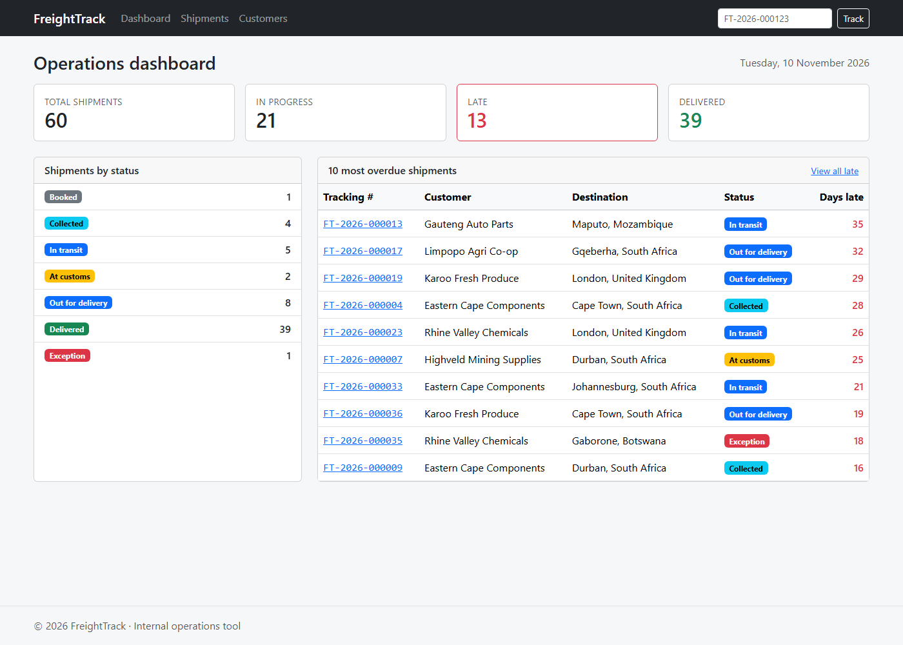
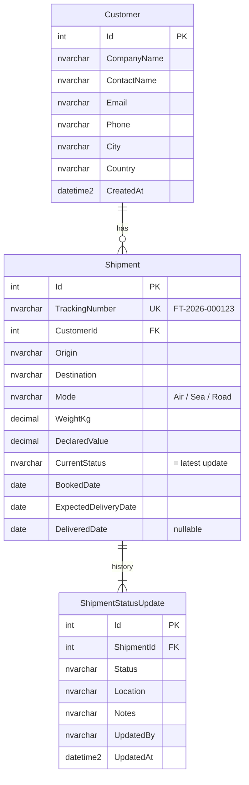

# FreightTrack: Shipment Tracking System

FreightTrack is an internal web app for a freight company's operations team. Staff record customers and their
shipments, move each shipment through its journey (booked → collected → in transit → at customs → out for
delivery → delivered), and look up any shipment by tracking number. Managers get a dashboard of what's in
progress and what's late. Business rules (forward-only status changes, a required note for exceptions,
auto-generated tracking numbers, input validation) live in a service layer and are covered by unit tests.



## Tech stack

| Area | Technology |
| --- | --- |
| Language / framework | C# 14, ASP.NET Core MVC on .NET 10 (LTS) |
| Database | Microsoft SQL Server 2022 Express |
| Data access | Entity Framework Core 10 (code-first migrations) + hand-written T-SQL (view, stored procedure, reports) |
| UI | Razor views + Bootstrap 5 |
| Tests | xUnit + EF Core with an in-memory SQLite database |
| Tooling | VS Code + C# Dev Kit (works the same in Visual Studio 2022), Git / GitHub |

## Running it locally

**Prerequisites:** [.NET 10 SDK](https://dotnet.microsoft.com/download) and SQL Server
(Express or LocalDB).

```powershell
git clone https://github.com/mutarisi-chibaya/FreightTrack.git
cd FreightTrack

# 1. Point the app at your SQL Server, in src/FreightTrack.Web/appsettings.json:
#      SQL Express (default):  Server=.\SQLEXPRESS;Database=FreightTrack;Trusted_Connection=True;TrustServerCertificate=True
#      LocalDB:                Server=(localdb)\MSSQLLocalDB;Database=FreightTrack;Trusted_Connection=True

# 2. Create the database (tables, indexes, view and stored procedure)
dotnet tool restore
dotnet ef database update --project src/FreightTrack.Web

# 3. Run. Demo data (15 customers, 60 shipments) is seeded on first start.
dotnet run --project src/FreightTrack.Web
```

Open http://localhost:5235. In Development, the app also applies pending migrations on startup, so step 2 is
optional on a fresh machine.

Run the tests:

```powershell
dotnet test
```

## Features

- **Dashboard:** counts by status, in-progress and late totals, and the 10 most overdue shipments.
- **Tracking lookup:** type a tracking number (e.g. `FT-2026-000012`) in the navbar and go straight to it.
- **Customers:** list, search by company or contact name, create, edit, and a details page with the customer's
  shipments and a status/weight summary from a **stored procedure**.
- **Shipments:** list with filters (status, mode, customer, late only) and paging, plus create, edit and details.
  Tracking numbers (`FT-{year}-{000001}`) are generated automatically and can't be edited.
- **Status updates:** a history timeline per shipment. Status only moves forward, any status can move to
  *Exception* (a note is required), *Delivered* is final and sets the delivered date.
- **Validation** on both client and server: required fields, valid email, weight > 0, and expected delivery
  can't be before the booked date.
- **SQL** in [`database/`](database/): `vw_LateShipments`, `usp_GetCustomerShipmentSummary`, report queries
  (JOINs, GROUP BY, a CTE, a correlated subquery, a window function, date filters) and the indexes with reasoning.

## Architecture

```
Browser ──► Controller ──► Service (business rules) ──► AppDbContext (EF Core) ──► SQL Server
              │                                                     └── SqlQuery ──► stored procedure
              └──► View model ──► Razor view
```

- **Controllers** only deal with HTTP: bind input, call a service, pick a view, and redirect after a POST.
- **Services** (`CustomerService`, `ShipmentService`, `ShipmentStatusRules`) hold every rule, so the rules are in
  one place, testable without a web server, and reusable by any future API.
- **View models** are what forms bind to, never entities. This prevents over-posting (for example, a forged form
  field can't change `TrackingNumber` or `CurrentStatus`).
- **Dependency injection** wires it all up in `Program.cs`. Even the clock (`TimeProvider`) is injected so
  tests can freeze "today".

## Data model



Indexes: unique `TrackingNumber`, `CustomerId` (FK), `(CurrentStatus, ExpectedDeliveryDate)` for the status
filter and late check, `(ShipmentId, UpdatedAt)` for the timeline, and `CompanyName`. See
[`database/indexes.sql`](database/indexes.sql) for why each one exists.

## Project structure

```
FreightTrack.sln
src/FreightTrack.Web/
  Controllers/     HomeController (dashboard), CustomersController, ShipmentsController
  Models/          Entities and enums
  ViewModels/      Form, list and page models
  Services/        Business rules
  Data/            AppDbContext, Migrations, SeedData
  Views/           Razor views
tests/FreightTrack.Tests/   xUnit tests (tracking numbers, status rules, late logic, validation)
database/          Hand-written T-SQL
```

## Planned next

- Export the filtered shipment list to CSV
- Login with ASP.NET Core Identity: *Clerk* (edit) and *Manager* (read-only + dashboard) roles
- `GET /api/shipments/{trackingNumber}` JSON endpoint
- GitHub Actions workflow to build and test on every push

## What I learned

- **C# vs Java:** properties instead of getters/setters, `async`/`await` with `Task<T>` everywhere I/O happens,
  nullable reference types (`string?`) catching null bugs at compile time, records, pattern matching and
  switch expressions, and extension methods.
- **ASP.NET Core MVC:** the request pipeline (middleware), conventional routing, model binding and validation,
  tag helpers, and the Post/Redirect/Get pattern with `TempData`.
- **Dependency injection** built into the framework (scoped vs singleton lifetimes), and why coding to
  interfaces makes testing easy.
- **EF Core:** code-first migrations, the Fluent API for keys and indexes, `IQueryable` building SQL lazily,
  `Include` for loading related data, and `AsNoTracking` for read-only queries.
- **LINQ vs raw SQL:** LINQ for everyday CRUD (type-safe, refactor-friendly), hand-written T-SQL for reporting
  where `ROLLUP`, CTEs and window functions are clearer, and calling a stored procedure safely with parameters.
- **SQL Server:** views, stored procedures, `CREATE OR ALTER`, sargable date filters, and choosing indexes.
